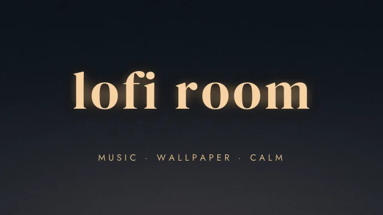
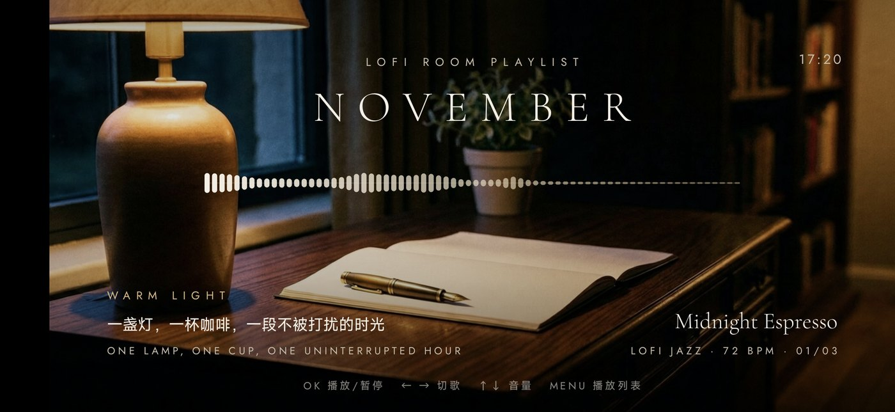
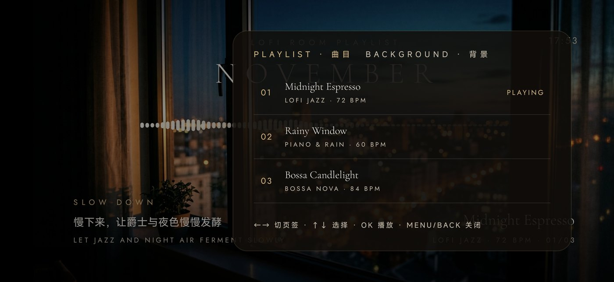

<div align="center">
  

  **开机即播的 Android TV 音乐壁纸播放器**

  暖光暗夜里的放松音乐、壁纸轮播与实时波形 · 遥控器与触摸皆可完整操控 · 手机扫码即可管理背景与音乐

  
  
  
  
  

  最新安装包见 [Releases](https://github.com/ycyx1994/lofi-room/releases)
</div>

# Lofi Room · CHILLNOVA

一个 Android TV 音乐壁纸播放器（`com.lofiroom.tv`，v1.9.2 / versionCode 12）：打开即播放松音乐
（lofi 爵士 / 咖啡馆氛围），壁纸轮播精美图片，中央优雅文字排版 + 实时音频波形。
零运行时权限，遥控器与触摸双交互；手机在同一局域网扫码即可上传背景与音乐，App 也能自更新。

## 效果

<p align="center">
  
  
  
</p>

## 功能

- **开机即播**：启动自动播放 9 首内置放松曲目 —— Alex Morgan 的 7 首（Jazz Ballad Rainy Night、
  Music On Hold Without a Beat、Ambient Corporate Soft Bed、Calm Piano for Quiet Moments、
  Emotional Piano With Soft Pads、Love Background Warm Tenderness、Ivory Keys Dark Piano Warmth）
  与 Lao Ban 的 2 首（Luxury Hotel BGM、Fine Dining BGM）
- **启动过渡**：`lofi` 字标遮罩淡入淡出，盖住首张壁纸的加载空窗
- **壁纸轮播**：14 张内置暖调壁纸（`wall_01..14.webp`），2 秒 smoothstep 缓动交叉溶解 +
  缓慢 Ken Burns 推镜（推近/拉远逐张交替）；面板可手动选图，自动切换默认关闭（开启后 15 分钟一换）；
  手机上传的自定义图片并入同一轮播序列
- **实时波形**：72 根对称圆角波形条，挂在播放器音频链路上实时分析（无需录音权限）
- **诗意文案**：4 组中英双语短句，随壁纸下标循环切换
- **主页标题**：显示当前英文月份，随月自动切换
- **自定义中心**：手机浏览器管理背景与音乐，无需装 App（见[下文](#自定义中心局域网-h5-管理页)）
- **应用内更新**：三源检测 + 断点续传 + 安装前三道闸 + Android 9+ 静默安装（见[下文](#应用内更新)）
- **遥控器 + 触摸双交互**：

  | 遥控器按键 | 功能 |
  |---|---|
  | OK / 确认 / 播放暂停键 | 播放 / 暂停 |
  | ← / →（短按，含「上一曲」「下一曲」媒体键） | 上一首 / 下一首 |
  | ← / →（长按） | 上一张 / 下一张壁纸（环形切换，并记忆选择） |
  | ↑ / ↓ | 音量 +5% / −5%（屏幕中央 OSD 提示） |
  | MENU / 设置 / INFO | 打开或关闭控制面板（曲目 / 背景 / 自定义三个页签；方向键漫游焦点，页签获得焦点即切换，OK 应用） |
  | BACK（面板打开时） | 只关面板 / 先关删除确认弹窗，不退出 |
  | BACK（主页） | 首击闪提示「再按一次返回键退出」，1.5 秒内再按退出（防误触打断氛围） |
  | OK（CUSTOM 页签） | 全屏二维码；焦点在「检查更新」按钮上时 OK 归按钮 |
  | 音量键 | 不拦截，交系统音量 |

  触摸手势（手机 / 平板 / 带触屏电视）：

  | 手势 | 功能 |
  |---|---|
  | 轻点 | 播放 / 暂停 |
  | 左滑 / 右滑 | 下一首 / 上一首（翻页式，与遥控器 ←→ 方向相反） |
  | 上滑 / 下滑 | 音量 +5% / −5% |
  | 长按 | 打开面板（点页签切换；曲目行点按播放；背景宫格点按应用、长按删自定义背景；点遮罩关闭面板） |

## 自定义中心（局域网 H5 管理页）

电视面板「CUSTOM · 自定义」页签显示二维码与地址，手机**在同一局域网**用浏览器打开即可管理自定义内容：
**无需安装 App，无需任何运行时权限**（`INTERNET` / `ACCESS_NETWORK_STATE` / `ACCESS_WIFI_STATE`
都是普通权限，安装即授予），也不需要路由器端口映射或账号登录。

- 服务由 NanoHTTPD 2.3.1 内嵌在 App 内，端口从 **8788** 起试、被占用顺延到 **8792**；
  网络变化（断网 / 换 IP）时二维码与地址自动刷新
- 所有路由都挂在 **`/t/{token}/`** 下：token 为 UUID 去横线的随机串，首次启动生成并存
  `SharedPreferences`（`lofi_prefs` / `lan_token`），裸路径与错 token 一律 404，避免同网段主机撞接口
- 管理页本体打包在 APK 内（`assets/h5/index.html`），打开即用，不联网加载前端资源
- 上传落盘到应用私有目录 `custom/`（`wallpapers/`、`music/`、`meta.json`），落盘名带
  `时间戳_随机_原名` 前缀防冲突；自定义项排在 9 首内置曲目 / 14 张内置壁纸之后，
  内置项不可改名或删除

| 方法与路径（前缀 `/t/{token}/`） | 作用 |
|---|---|
| `GET /` | H5 管理页 |
| `GET api/state` | 播放状态 / 当前曲目 / 当前壁纸下标 |
| `GET api/wallpapers` | 壁纸列表（id、缓存键、展示名、是否内置） |
| `POST api/wallpapers` | 上传壁纸，multipart 字段 `file`，`jpg/jpeg/png/webp`，单张 ≤20MB；落盘前做图片边界校验，成功即让电视切到该图 |
| `GET api/thumbs/wall/{id}` | 缩略图（≤320px JPEG，本地缓存 1 小时） |
| `POST api/wallpapers/{id}/apply` | 应用某张壁纸 |
| `DELETE api/wallpapers/{id}` | 删除自定义壁纸（内置项拒绝） |
| `GET api/tracks` | 曲目列表 |
| `POST api/tracks` | 上传音乐，multipart 字段 `file`，`mp3/m4a/wav/aac/flac/ogg`，单曲 ≤100MB，可带 `title` / `sub` |
| `POST api/tracks/{id}/play` | 切到该曲目播放 |
| `POST api/tracks/{id}/move?dir=-1\|1` | 自定义曲目上移 / 下移 |
| `PATCH api/tracks/{id}` | 重命名（`title` / `sub`） |
| `DELETE api/tracks/{id}` | 删除自定义曲目 |
| `GET api/export?part=all\|wall\|music` | 导出备份 zip |
| `POST api/import?mode=replace\|merge` | 导入备份 zip |

上传/导入期间电视端会收到库变更回调：重建播放列表（尽量保留当前曲目与进度）、重载壁纸、补温缩略图。

## 备份导出 / 导入

- **导出**：`api/export?part=all|wall|music` 现场打包 zip，结构与落盘一致 ——
  `manifest.json`（`app` / `part` / 文件清单与字节数）+ `meta.json`（展示名与顺序）+
  `wallpapers/` + `music/`。`part` 分包便于大音乐库分批下载；临时包生成在外部 cache 目录，
  下载结束或中断即删，另有 1 小时残留兜底清理
- **导入**：`api/import?mode=replace|merge`（默认 `replace`）
  - `replace`：整库替换。先把现有 `custom/` 改名为 `custom.bak`，再把解压结果原子替换上去，
    成功后才删备份；任何一步失败立即回滚到 `custom.bak`
  - `merge`：合并导入。逐文件重新生成落盘名后追加，展示名尽量沿用备份里的 meta
- **校验**（fail-closed）：拒绝路径穿越（`..`、绝对路径、异常前缀）与白名单外的扩展名；
  zip 条目上限 **2000**，解压总量上限 **1GB**，单张图 ≤20MB、单曲 ≤100MB、meta ≤2MB，
  上传 zip 本身 ≤512MB；导入完成后按实际落盘文件重建 meta，备份里的脏引用不会带进库

## 应用内更新

- **检查时机**（`UpdateScheduler` 纯逻辑调度，判定可单测）
  - 启动 / 回前台：3 小时内不重复检测
  - 打开控制面板：新鲜度缩到 10 分钟（用户主动找新版）
  - 网络恢复：2 秒合并窗口内只排一次，两次网络触发至少间隔 5 秒
  - 失败退避：30s → 2min → 10min → 30min 封顶，成功清零；退避重试只在前台跑
  - CUSTOM 页签「检查更新」按钮手动旁路节流；检测进行中重复触发直接跳过
- **三源**：R2 镜像（`version.txt` / `notes.txt`，无 API 限流）→ GitHub Releases API 兜底；
  下载源按序降级：镜像 APK → 固定名直链 `lofiroom-latest.apk` → API 资产直链。
  版本串过白名单正则（只接受点分数字），非法响应按检测失败处理
- **下载**：写 `.part` 断点续传（`Range` + 206，同源最多重试 3 次；服务端不支持 Range 则重下），
  30 秒窗口内增量 <256KB 判卡死并换源，完成后校验字节总数对得上才改名为正式 APK；
  取消或换版本时清理半成品
- **安装前三道闸**（任一不过即拒收）：包名与本应用一致 / 签名与已装版本一致 /
  归档 versionCode 不低于当前安装（防镜像未更新的回滚）
- **安装**：Android 9（API 28）及以上走 `PackageInstaller` Session 静默装（声明是更新自身、
  请求无需用户操作；8 秒等应答、120 秒总超时、确认页 1.5 秒闪退判定），
  资格不足或失败降级 `ACTION_VIEW` 拉起系统安装器（FileProvider 授权）。
  系统是否放行静默装由固件与安装来源信任决定，不放行时会出现系统确认页
- **状态展示**：CUSTOM 页签一行按钮 + 状态行（检查中 / 已是最新 / 发现新版 / 下载中 N% /
  校验中 / 失败原因）+ release notes 前两行摘要；升级后 2 分钟内启动会显示「已更新到 vX.Y」
- **发布演练**（仅 debug 包）：`adb shell am broadcast -a com.lofiroom.tv.UPDATE_TEST --ez update_test true`
  可跳过网络下载，直接走「三道闸 → 安装」链路（包名/签名/版本任一不符即丢弃）。
  该 receiver 只声明在 `app/src/debug/` 源集（清单 + 类），release 包既无组件也无字节码，
  且执行前还会校验 `FLAG_DEBUGGABLE`，外部应用无法借此拉起安装流程

## 构建

```bash
# debug：无需任何密钥
./gradlew :app:assembleDebug
# 产物：app/build/outputs/apk/debug/app-debug.apk
```

```bash
# release：要求本机存在正式密钥，否则构建失败
#   keystore.properties（storeFile / storePassword / keyAlias / keyPassword）
#   keystore/lofiroom-release.jks
./gradlew :app:assembleRelease
```

安装到电视盒子：

```bash
adb connect [TV_IP]
adb install -r app/build/outputs/apk/debug/app-debug.apk
```

环境要求：JDK 17；Android SDK（compileSdk 36，targetSdk 34，minSdk 21）；
Gradle 8.11.1 由 wrapper 自动下载（AGP 8.9.3 / Kotlin 2.1.20）。

CI 由 `.github/workflows/release.yml` 负责：push `v*` tag（或手动触发 workflow）时用 JDK 17
先跑 `testReleaseUnitTest` 与 `lintRelease`（任一失败即中断，不产出包），再还原签名密钥、
构建 release 包、打印签名 SHA256，并创建 GitHub Release 挂上 `lofiroom-<tag>.apk` 与固定名
`lofiroom-latest.apk`（应用内更新的固定直链就是它）。

release 变体开了 R8（`isMinifyEnabled` + `isShrinkResources`）：dex 从 ~20MB 未压缩降到
~6MB，产物 28.8MB（其中 19.6MB 是 9 首 m4a 音频，已压缩格式，继续瘦身只能降码率）。
保留规则见 `app/proguard-rules.pro`（media3 / nanohttpd / zxing / audio 包整包 keep）。

## 目录结构

```
app/src/debug/                     # 仅 debug 变体：UpdateTestReceiver（adb 发布演练钩子）
app/src/main/
├── java/com/lofiroom/tv/
│   ├── MainActivity.kt            # 主界面 / 遥控器与触摸交互 / 面板 / 文案联动 / 局域网服务与更新接线
│   ├── audio/
│   │   ├── AudioEngine.kt         # ExoPlayer + TeeAudioProcessor 音频引擎
│   │   └── VisualizerTap.kt       # PCM 采集 + Goertzel 频带分析
│   ├── ui/
│   │   ├── PanelCompose.kt        # 控制面板（Compose for TV：页签 / 曲目 / 背景宫格 / 自定义页）
│   │   ├── WallpaperView.kt       # 壁纸轮播（缓动溶解 + Ken Burns）
│   │   └── VisualizerView.kt      # 音频波形条绘制
│   ├── custom/
│   │   └── CustomLibrary.kt       # 自定义内容库：内置 + 上传合并视图、meta 持久化、备份导入导出
│   ├── net/
│   │   ├── LanServer.kt           # 局域网 H5 管理页（NanoHTTPD，/t/{token}/ 路由）
│   │   ├── QrCode.kt              # zxing 二维码编码（仅 core，不引 javase）
│   │   ├── UpdateChecker.kt       # 多源检测 / 版本比较 / 断点续传下载 / 安装前三道闸
│   │   ├── UpdateInstaller.kt     # PackageInstaller 静默装 + ACTION_VIEW 降级链
│   │   ├── UpdateScheduler.kt     # 检测节流 / 退避 / 网络事件合并（纯逻辑，可 JVM 单测）
│   │   ├── UpdateState.kt         # 更新状态机与失败原因
│   │   └── UpdateResultReceiver.kt# PackageInstaller session 结果回执
│   └── data/Playlist.kt           # 曲目、壁纸与文案数据
├── assets/
│   ├── music/                     # 9 首内置曲目 (.m4a)
│   ├── wallpapers/                # 14 张壁纸 (wall_01..14.webp)
│   ├── h5/                        # 手机端管理页 index.html
│   └── fonts/                     # Cormorant Garamond + Jost
└── res/
    ├── layout/activity_main.xml   # 主布局（含启动遮罩与面板）
    ├── xml/file_paths.xml         # FileProvider 路径（安装包外发）
    └── drawable/                  # 渐变遮罩 / 面板背景 / 字标 / TV banner
```

## 自定义

日常增删背景与音乐走手机管理页即可，不必重新构建；下面这些是替换内置素材的做法：

- **换壁纸**：替换 `app/src/main/assets/wallpapers/` 下的图片（建议 2560 宽 16:9），
  同步调整 `app/src/main/java/com/lofiroom/tv/data/Playlist.kt` 中 `wallpapers` 的数量与展示名
- **换音乐**：替换 `app/src/main/assets/music/` 下的 `.m4a`，同步修改 `Playlist.kt` 中的曲目元数据
- **换文案**：修改 `Playlist.kt` 中的 `captions`
- **素材处理**：`tools/process_wallpapers.py`（壁纸管线 + 图标 / banner / 启动字标）；
  `tools/generate_music.py`（numpy 合成曲目）可复现 `archive/builtin_music/` 中归档的旧内置曲目

## 技术要点

- 波形可视化走 `DefaultAudioSink.Builder.setAudioProcessors(TeeAudioProcessor)`，
  在解码 PCM 旁路取样做 Goertzel 频带分析——不占麦克风、不需要任何运行时权限
- 壁纸过渡：smoothstep 缓动交叉溶解，旧图淡出期沿自身推镜轨迹续行，消除缩放跳变；
  Ken Burns 推近/拉远逐张交替；淡入淡出期全帧率、静止段隔帧绘制以照顾低端盒子
- 字体：Cormorant Garamond（衬线标题）+ Jost（几何无衬线标签），随包加载；
  品牌字标为 DM Serif Display 小写 `lofi` 暖金光晕（OFL）
- Media3 ExoPlayer 1.4.1，minSdk 21，leanback launcher 适配；坏曲目自动跳下一首，连续失败一轮即停
- 控制面板用 Compose for TV（`androidx.tv:tv-material` 1.0.1 + Compose 1.8.1）：
  遥控/触摸交互走 Compose 焦点系统，视觉沿用手绘时代设计语言；版本组合守住 minSdk 21
- 局域网管理页：NanoHTTPD 2.3.1 + zxing core 3.5.3（只做二维码编码）；上传走 multipart
  临时文件，接口全部挂在随机 token 前缀下
- 更新链路：`UpdateChecker`（版本白名单/数值比较/续传下载/三道闸）与 `UpdateScheduler`
  （新鲜度/退避/网络合并）为纯逻辑，配 JVM 单测（junit 4.13.2）
