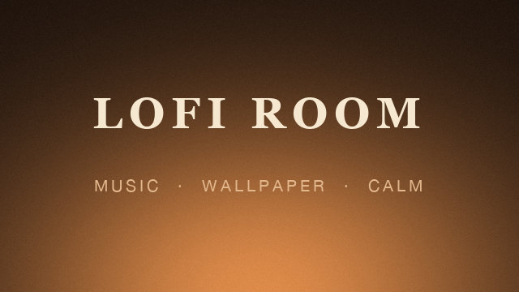
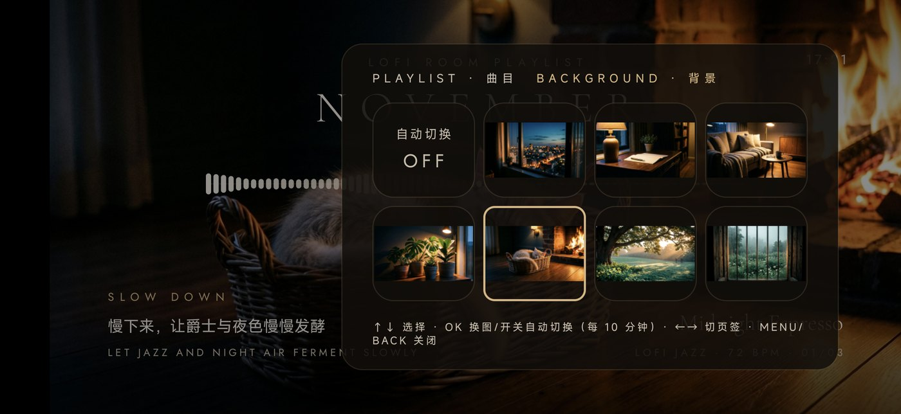

<div align="center">
  

  **开机即播的 Android TV 音乐壁纸播放器**

  暖光暗夜里的放松音乐、壁纸轮播与实时波形 · 遥控器与触摸皆可完整操控

  
  
  
  
  

  最新安装包见 [Releases](https://github.com/ycyx1994/lofi-room/releases)
</div>

# Lofi Room · CHILLNOVA

一个 Android TV 音乐壁纸播放器：打开即播放松音乐（lofi 爵士 / 咖啡馆氛围），
壁纸轮播精美图片，中央优雅文字排版 + 实时音频波形。零运行时权限，遥控器与触摸双交互。

## 效果

<p align="center">
  
  
  
</p>

## 功能

- **开机即播**：启动自动播放 3 首内置放松曲目（自合成，免版权）
- **启动过渡**：`lofi` 字标遮罩淡入淡出，盖住首张壁纸的加载空窗
- **壁纸轮播**：7 张暖调壁纸，交叉溶解 + Ken Burns 缓慢推镜；面板可手动选图，自动切换默认关闭（开启后 10 分钟一换）
- **实时波形**：72 根对称圆角波形条，挂在播放器音频链路上实时分析（无需录音权限）
- **诗意文案**：每换一张壁纸，左下角文案随之切换（中英双语）
- **主页标题**：显示当前英文月份，随月自动切换
- **遥控器 + 触摸双交互**：

  | 遥控器按键 | 功能 |
  |---|---|
  | OK / 播放暂停 | 播放 / 暂停 |
  | ← / → | 上一首 / 下一首 |
  | ↑ / ↓ | 音量 +5% / −5%（屏幕中央 OSD 提示） |
  | MENU / 设置 / INFO | 面板（←→ 切页签：曲目 / 背景，↑↓ 选择，OK 应用） |
  | BACK | 收起提示 / 关闭面板（不退出，保持氛围） |

  触摸手势（手机 / 平板 / 带触屏电视）：

  | 手势 | 功能 |
  |---|---|
  | 轻点 | 播放 / 暂停 |
  | 左滑 / 右滑 | 下一首 / 上一首（翻页式，与遥控器 ←→ 方向相反） |
  | 上滑 / 下滑 | 音量 +5% / −5% |
  | 长按 | 面板（点按页签切换曲目 / 背景，点按行应用） |

## 构建

```bash
./gradlew :app:assembleDebug
# 产物：app/build/outputs/apk/debug/app-debug.apk
```

安装到电视盒子：

```bash
adb connect [TV_IP]
adb install -r app/build/outputs/apk/debug/app-debug.apk
```

环境要求：JDK 17、Android SDK（compileSdk 34）。Gradle 8.9 由 wrapper 自动下载。

## 目录结构

```
app/src/main/
├── java/com/lofiroom/tv/
│   ├── MainActivity.kt            # 主界面 / 遥控器与触摸交互 / 面板 / 文案联动
│   ├── audio/
│   │   ├── AudioEngine.kt         # ExoPlayer + TeeAudioProcessor 音频引擎
│   │   └── VisualizerTap.kt       # PCM 采集 + Goertzel 频带分析
│   ├── ui/
│   │   ├── WallpaperView.kt       # 壁纸轮播（缓动溶解 + Ken Burns）
│   │   └── VisualizerView.kt      # 音频波形条绘制
│   └── data/Playlist.kt           # 曲目、壁纸与文案数据
├── assets/
│   ├── music/                     # 3 首内置曲目 (.m4a)
│   ├── wallpapers/                # 7 张壁纸 (wall_01..07.jpg)
│   └── fonts/                     # Cormorant Garamond + Jost
└── res/
    ├── layout/activity_main.xml   # 主布局（含启动遮罩与面板）
    └── drawable/                  # 渐变遮罩 / 面板背景 / 字标 / TV banner
```

## 自定义

- **换壁纸**：替换 `app/src/main/assets/wallpapers/` 下的图片（建议 2560 宽 16:9），重新构建
- **换音乐**：替换 `app/src/main/assets/music/` 下的 `.m4a`，同步修改
  `app/src/main/java/com/lofiroom/tv/data/Playlist.kt` 中的曲目元数据
- **换文案**：修改 `Playlist.kt` 中的 `captions`
- **素材处理**：`tools/process_wallpapers.py`（壁纸管线 + 图标 / banner / 启动字标）、
  `tools/generate_music.py`（numpy 合成三首曲目）可复现全部内置素材

## 技术要点

- 波形可视化走 `DefaultAudioSink.Builder.setAudioProcessors(TeeAudioProcessor)`，
  在解码 PCM 旁路取样做 Goertzel 频带分析——不占麦克风、不需要任何运行时权限
- 壁纸过渡：smoothstep 缓动交叉溶解，旧图淡出期沿自身推镜轨迹续行，消除缩放跳变；
  Ken Burns 推近/拉远逐张交替
- 字体：Cormorant Garamond（衬线标题）+ Jost（几何无衬线标签），随包加载；
  品牌字标为 DM Serif Display 小写 `lofi` 暖金光晕（OFL）
- Media3 ExoPlayer 1.4.1，minSdk 21，leanback launcher 适配
